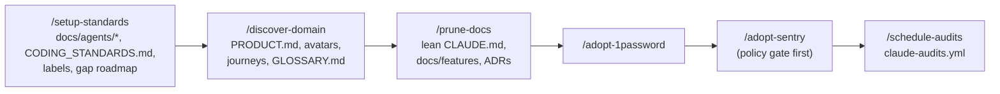
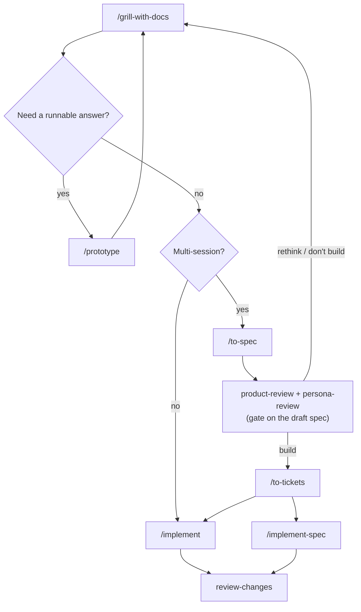
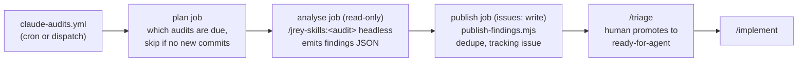
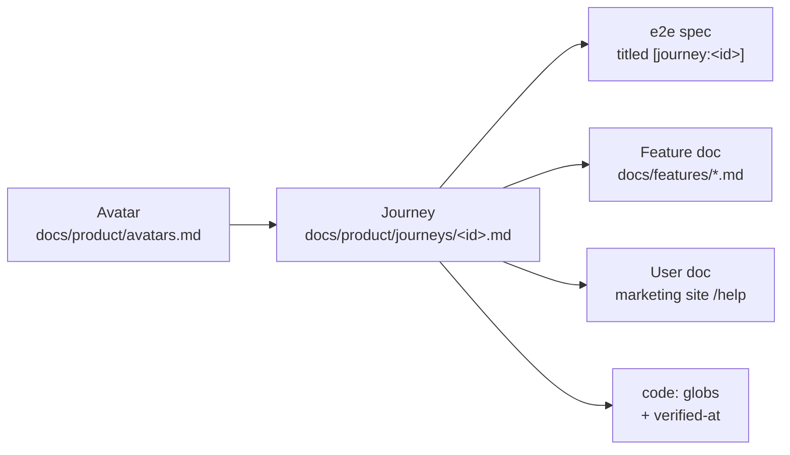
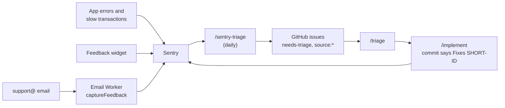
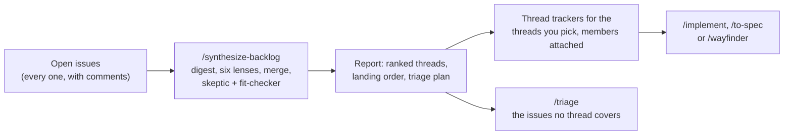

# Workflows

How the skills chain together. For a quick "which one do I need?", type `/which-skill`.

## 1. Adopting the standard in a repo

Run once per repo. Each step leaves files the next one reads.

The order matters a little: the product model gives the audits something to judge against, a lean `CLAUDE.md` makes every later run cheaper, and the scheduled workflow needs the 1Password service account.

## 2. Idea to shipped feature

Building means tdd at agreed seams, in the house style. Done means tests at those seams, a feature doc, a user doc if the change is user-visible, journey links updated, and an ADR if the decision was hard to reverse.

Each build runs in its own git worktree, so sessions can work in parallel. `implement` sweeps away worktrees whose work has merged, starts a fresh one, and ends with a pushed branch and a PR. The next sweep removes that worktree once the PR merges (proven by git or the forge, never by the issue closing). Type `/worktree` to sweep at any time.

## 3. The audit loop

- **Read and write are separated.** The model that reads Sentry events, feedback or code holds no write access; a deterministic script publishes.
- **Dedupe across runs.** Each finding has a fingerprint. Open issues are left alone, issues closed as completed reopen as regressions, and issues closed as not planned stay closed.
- **Untrusted sources never skip a human.** Issues derived from Sentry, feedback or email are labelled `source:*` and `needs-triage`. Only a human makes them agent-ready.

Run any audit interactively to pick which findings to file and to grill the top one.

## 4. The journey join

| Audit | Uses the join to find |
|---|---|
| test-audit | Core journeys with no e2e spec |
| docs-audit | Journeys with no feature or user doc; docs whose code changed after `verified-at` |
| persona-review | The steps to walk, and as which avatar |
| product-review | Which avatar job a feature serves |
| sentry-triage | Which journey an error breaks (stack frames against `code:` globs) |

## 5. Errors and feedback

## 6. A backlog that has piled up

When audits and agent runs file issues faster than anyone can triage them, synthesize first, then triage what's left.

- **Threads, not topics.** A thread is one cause in the code and one change that removes it; grouping by product area doesn't count.
- **Verified against what is live.** Agents read a detached checkout of the default branch's tip, never a local checkout that may be behind.
- **Read-only until you pick.** The run writes only to a temp directory and a temporary detached checkout; thread trackers appear only for the threads you choose, and the next run extends them.
